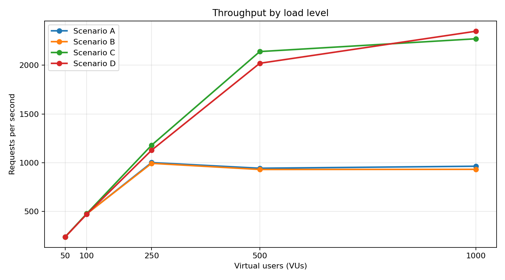
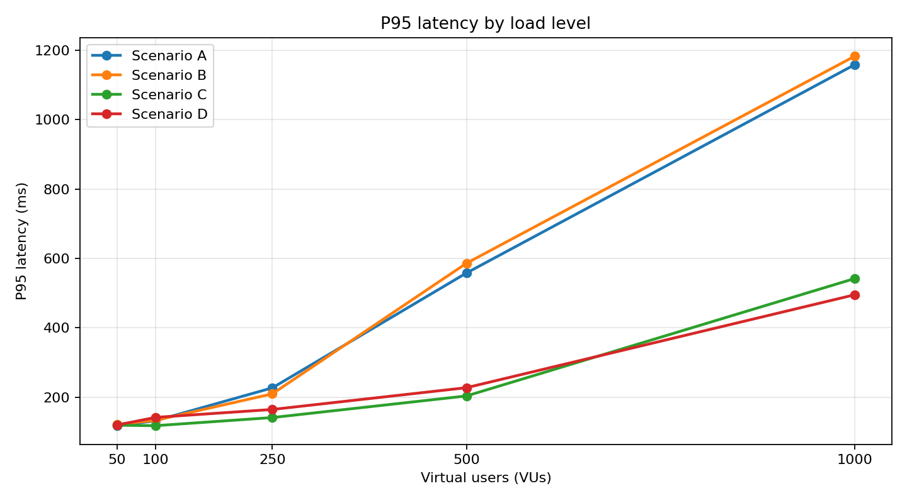
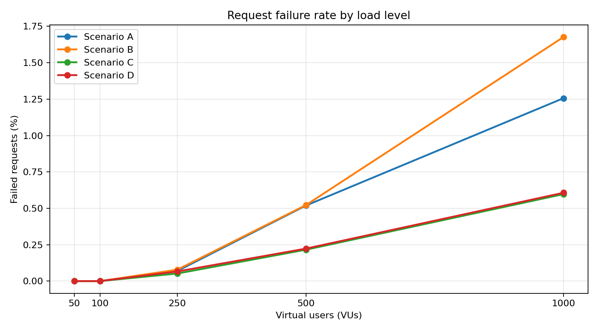
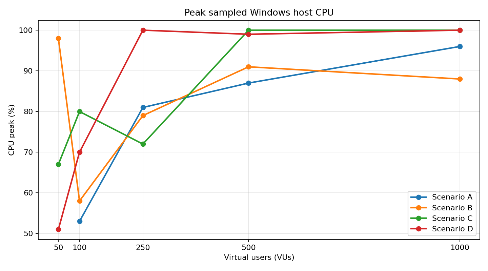
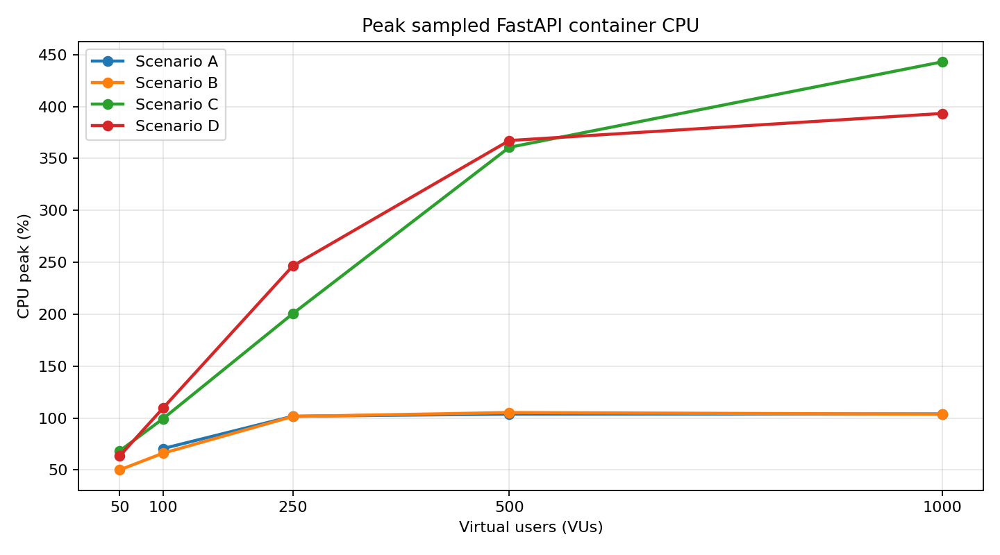
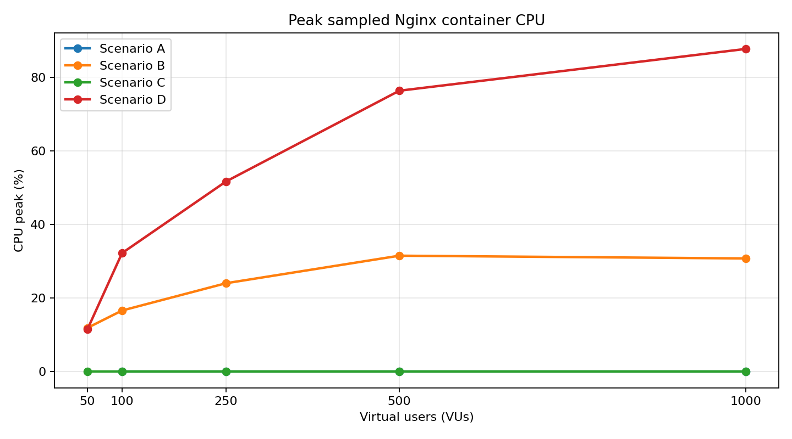
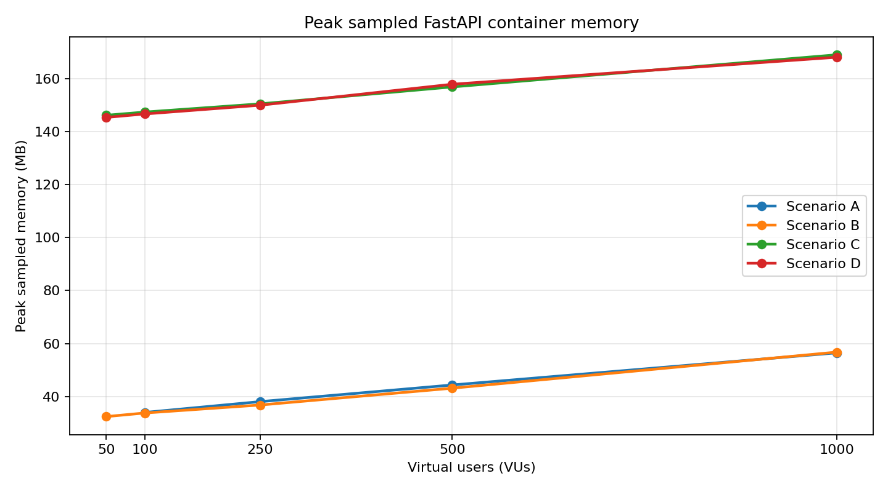
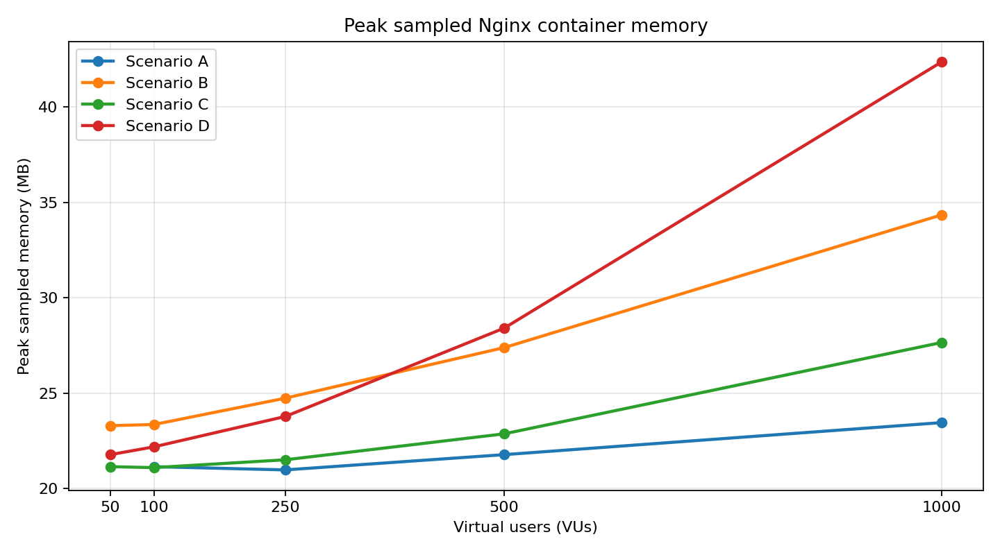

# HTTP Performance Benchmarking with Docker, Nginx, FastAPI & k6

## 1. Executive summary

This project implements a repeatable HTTP load-testing environment on Windows using Docker Desktop, Docker Compose, FastAPI/Uvicorn, Nginx, PowerShell monitoring, and Grafana k6.

The benchmark compared four request paths and worker configurations at 50, 100, 250, 500, and 1,000 virtual users (VUs), with a 60-second test duration per run.

**Main findings:**

- Four Uvicorn workers substantially improved throughput at high concurrency. At 1,000 VUs, the four-worker scenarios achieved approximately 2,272–2,349 RPS, compared with approximately 933–965 RPS for one worker.
- At 500 and 1,000 VUs, one-worker scenarios showed sharply increased latency while throughput largely plateaued.
- The best single recorded throughput was Scenario D (Nginx + four workers) at 1,000 VUs: **2,349.08 RPS**.
- The best recorded P95 latency at 1,000 VUs was also Scenario D: **495.36 ms**, although the difference from direct Scenario C should not be treated as proof that Nginx improves performance.
- Request failures increased with load. At 1,000 VUs, failure rates ranged from **0.597% to 1.677%**.
- Resource samples show the Windows host reaching 100% sampled CPU in several high-load runs. Memory was not close to the reported Docker container memory limit.

The 1,000-VU test was the final load level. No 2,000-VU test was performed.

## 2. Architecture and implementation

### Components

- **FastAPI** provides `GET /api/test`, performs a small asynchronous simulated operation, logs processed requests, and returns a JSON response containing status, message, and processing time.
- **Uvicorn** serves the ASGI application. Worker count is configured with `WEB_CONCURRENCY`.
- **Nginx** listens on container port 80, published on host port 8080, and proxies `/api/` requests to the Docker Compose service `backend:8000`.
- **Docker Compose** starts and recreates the backend and Nginx services.
- **k6** runs on the Windows host and generates virtual-user traffic.
- **PowerShell monitoring** samples Windows host CPU/RAM and Docker container CPU/RAM using CIM and `docker stats`.

### Request paths

| Scenario | Request path | FastAPI workers |
|:---:|---|---:|
| A | k6 → FastAPI (`localhost:8000`) | 1 |
| B | k6 → Nginx (`localhost:8080`) → FastAPI | 1 |
| C | k6 → FastAPI (`localhost:8000`) | 4 |
| D | k6 → Nginx (`localhost:8080`) → FastAPI | 4 |

Scenario E (Nginx static response) was optional in the task and was not implemented as a benchmark scenario.

### Important configuration notes

- `WEB_CONCURRENCY` controls Uvicorn worker count. The automation script selects 1 or 4 workers for each scenario and recreates the backend so the selected value takes effect.
- Nginx uses an upstream named `backend_servers`, HTTP/1.1 upstream connections, proxy headers, `worker_processes auto`, `worker_connections 4096`, and `keepalive 64`.
- The Nginx `worker_connections` value is a connection capacity setting, not a requests-per-second setting. Actual capacity also depends on file descriptors and host/container limits.
- The Nginx `keepalive 64` setting controls idle upstream keepalive connections per worker; it is not a cap on all active requests.

## 3. Test methodology

- Load levels: **50, 100, 250, 500, and 1,000 VUs**.
- Duration: **60 seconds** for each recorded summary.
- Scenarios: A, B, C, and D at every listed load level.
- Tests were run sequentially for the final comparison set. The earlier 250-VU results that were run concurrently were not used in this report.
- The runner performs a readiness request before starting k6 and starts the metrics collector around the benchmark execution.
- Each scenario/load combination in the supplied summary set has one recorded run. Three repetitions were not completed for every combination, so the results are comparative observations rather than statistically established averages.

**Scope limitations:**

- The task specification listed 10 VUs as an additional load level; the supplied final summary files begin at 50 VUs. No 10-VU result was provided.
- The exported summary CSVs include P50, P90, and P95, but do not include P99, minimum latency, or a separate peak-RPS metric. These values are not fabricated or estimated in this report.
- The summary exports do not provide a separate successful-request count. It can be derived as total requests minus failed requests when the failed-request count is present.
- The k6 process itself was not independently monitored. Host CPU/RAM and the FastAPI/Nginx containers were monitored.
- The resource collector records periodic samples around the run. Its average and peak values are sampled observations over the collector window, which can include a short pre-test and post-test period. They are not exact per-request or perfectly clipped 60-second measurements.
- The A/50 summary export has a blank `FailedRequests` and `FailureRate` field, although its `FailedChecks` value is zero. The report marks the failed-request count as `0*` based on the zero failed checks; the explicit failure-rate field remains unavailable.

## 4. Benchmark results

All latency values are milliseconds. Failure rate is the fraction of HTTP requests marked failed by k6, shown as a percentage.

| VUs | Scenario | Workers | Requests | RPS | Avg (ms) | P50 (ms) | P90 (ms) | P95 (ms) | Max (ms) | Failed | Failure rate |
|---:|:---:|---:|---:|---:|---:|---:|---:|---:|---:|---:|---:|
| 50 | A | 1 | 14,469 | 240.30 | 106.83 | 105.24 | 111.13 | 117.14 | 183.27 | 0* | N/A |
| 50 | B | 1 | 14,390 | 239.13 | 107.98 | 105.80 | 114.51 | 121.18 | 180.18 | 0 | 0.000% |
| 50 | C | 4 | 14,379 | 238.87 | 107.97 | 105.93 | 113.28 | 118.94 | 191.46 | 0 | 0.000% |
| 50 | D | 4 | 14,347 | 238.30 | 108.62 | 106.31 | 114.53 | 119.65 | 190.51 | 0 | 0.000% |
| 100 | A | 1 | 28,649 | 475.58 | 109.16 | 105.25 | 118.06 | 132.23 | 211.87 | 0 | 0.000% |
| 100 | B | 1 | 28,647 | 475.83 | 108.96 | 104.94 | 120.63 | 133.26 | 210.58 | 0 | 0.000% |
| 100 | C | 4 | 28,825 | 478.80 | 107.34 | 105.09 | 112.48 | 117.77 | 231.05 | 0 | 0.000% |
| 100 | D | 4 | 28,448 | 472.45 | 110.14 | 106.22 | 118.97 | 141.70 | 263.78 | 0 | 0.000% |
| 250 | A | 1 | 60,442 | 1,002.23 | 147.77 | 137.60 | 190.53 | 226.73 | 357.57 | 42 | 0.069% |
| 250 | B | 1 | 59,878 | 994.34 | 150.20 | 142.83 | 189.97 | 209.48 | 430.81 | 47 | 0.078% |
| 250 | C | 4 | 71,084 | 1,180.68 | 110.15 | 104.74 | 122.15 | 141.12 | 251.84 | 37 | 0.052% |
| 250 | D | 4 | 67,981 | 1,129.00 | 119.39 | 109.42 | 151.66 | 164.47 | 285.80 | 45 | 0.066% |
| 500 | A | 1 | 56,989 | 944.04 | 426.21 | 415.09 | 531.77 | 558.10 | 801.27 | 296 | 0.519% |
| 500 | B | 1 | 56,251 | 931.36 | 433.13 | 420.32 | 524.63 | 586.20 | 912.53 | 294 | 0.523% |
| 500 | C | 4 | 128,872 | 2,140.19 | 130.30 | 117.47 | 176.68 | 203.49 | 510.77 | 278 | 0.216% |
| 500 | D | 4 | 121,792 | 2,020.07 | 143.96 | 128.18 | 194.77 | 227.32 | 704.28 | 272 | 0.223% |
| 1000 | A | 1 | 58,655 | 964.77 | 925.52 | 915.36 | 1,096.76 | 1,159.11 | 1,406.90 | 737 | 1.256% |
| 1000 | B | 1 | 56,602 | 932.69 | 957.19 | 955.49 | 1,128.40 | 1,183.55 | 2,003.44 | 949 | 1.677% |
| 1000 | C | 4 | 137,086 | 2,271.54 | 332.29 | 311.95 | 477.45 | 542.24 | 897.26 | 819 | 0.597% |
| 1000 | D | 4 | 141,722 | 2,349.08 | 320.40 | 307.52 | 445.21 | 495.36 | 794.62 | 860 | 0.607% |

\* Scenario A at 50 VUs: the exported summary has zero failed checks but no explicit failed-request count or failure-rate value.

### Throughput across load levels

### P95 latency across load levels

### Request failure rate

## 5. Analysis

### 5.1 Impact of increasing workers

At 1,000 VUs:

- Direct FastAPI (A → C): RPS increased from **964.77** to **2,271.54**, approximately **135.5%** higher. Average latency decreased from **925.52 ms** to **332.29 ms**.
- Nginx path (B → D): RPS increased from **932.69** to **2,349.08**, approximately **151.8%** higher. Average latency decreased from **957.19 ms** to **320.40 ms**.

At 500 VUs, the same pattern was already visible: the four-worker scenarios delivered roughly 2,020–2,140 RPS, while the one-worker scenarios delivered roughly 931–944 RPS.

The workload uses `asyncio.sleep(0.1)` to simulate an asynchronous I/O-bound operation. Therefore, the observed worker-count benefit should be interpreted in the context of this particular application and test environment. It is not a universal claim that every async FastAPI application needs four workers.

### 5.2 Impact of Nginx

Nginx comparisons are A vs B (one worker) and C vs D (four workers).

- At 50–500 VUs, the direct path generally recorded slightly higher throughput than the Nginx path.
- At 1,000 VUs, Scenario D recorded 2,349.08 RPS versus 2,271.54 RPS for C, and also recorded lower latency percentiles in this single run.
- The direction of the difference changes across load levels. Therefore, these runs do not establish a consistent performance advantage for either direct access or Nginx proxying.

Nginx still provides reverse-proxy functionality, a stable external entry point, routing, and request-header forwarding. Its value is architectural as well as performance-related.

### 5.3 Saturation and latency growth

The increase from 500 to 1,000 VUs did not double throughput:

| Scenario | RPS at 500 VUs | RPS at 1,000 VUs | Change |
|:---:|---:|---:|---:|
| A | 944.04 | 964.77 | +2.2% |
| B | 931.36 | 932.69 | +0.1% |
| C | 2,140.19 | 2,271.54 | +6.1% |
| D | 2,020.07 | 2,349.08 | +16.3% |

Meanwhile, average latency rose substantially from 500 to 1,000 VUs:

- A: 426.21 ms → 925.52 ms
- B: 433.13 ms → 957.19 ms
- C: 130.30 ms → 332.29 ms
- D: 143.96 ms → 320.40 ms

This combination of limited throughput growth and sharply increasing latency is consistent with the test environment approaching a capacity limit. The resource samples also show the Windows host reaching 100% sampled CPU in several high-load runs. CPU contention is therefore a plausible contributor, but the available measurements do not isolate a single definitive bottleneck.

### 5.4 Request failures

| VUs | A failure rate | B failure rate | C failure rate | D failure rate |
|---:|---:|---:|---:|---:|
| 50 | N/A* | 0.000% | 0.000% | 0.000% |
| 100 | 0.000% | 0.000% | 0.000% | 0.000% |
| 250 | 0.069% | 0.078% | 0.052% | 0.066% |
| 500 | 0.519% | 0.523% | 0.216% | 0.223% |
| 1,000 | 1.256% | 1.677% | 0.597% | 0.607% |

\* A/50 has zero failed checks, but its summary export does not contain an explicit failure-rate value.

The failure rate rises as concurrency increases. Four workers reduce the observed failure percentage compared with one worker at 500 and 1,000 VUs, but failures remain present. The 1,000-VU results should not be described as error-free or fully stable.

## 6. Resource monitoring results

The following table reports averages and peaks from the supplied periodic CSV samples for the 500- and 1,000-VU runs. CPU percentages for Docker containers use Docker's CPU accounting and can exceed 100% because they are expressed relative to one CPU core. Host CPU percentage is a separate Windows host measure. **Do not add host and container CPU or RAM values together**, because container activity is part of the host workload.

| VUs | Scenario | Host CPU avg/peak | Host RAM peak | Backend CPU avg/peak | Backend RAM peak | Nginx CPU avg/peak | Nginx RAM peak |
|---:|:---:|---:|---:|---:|---:|---:|---:|
| 500 | A | 63.0/87.0% | 11,948 MB | 94.7/103.8% | 44.4 MB | 0.0/0.0% | 21.8 MB |
| 500 | B | 64.9/91.0% | 12,071 MB | 91.2/105.3% | 43.2 MB | 23.9/31.5% | 27.4 MB |
| 500 | C | 89.2/100.0% | 11,693 MB | 269.6/360.7% | 156.8 MB | 0.0/0.0% | 22.9 MB |
| 500 | D | 80.7/99.0% | 11,781 MB | 276.4/367.3% | 157.8 MB | 52.5/76.3% | 28.4 MB |
| 1000 | A | 61.1/96.0% | 11,887 MB | 94.8/104.0% | 56.5 MB | 0.0/0.0% | 23.4 MB |
| 1000 | B | 58.1/88.0% | 11,966 MB | 88.1/103.7% | 56.8 MB | 21.0/30.8% | 34.3 MB |
| 1000 | C | 88.0/100.0% | 12,105 MB | 358.1/443.1% | 168.9 MB | 0.0/0.0% | 27.6 MB |
| 1000 | D | 90.6/100.0% | 13,722 MB | 348.0/393.4% | 168.0 MB | 67.7/87.7% | 42.4 MB |

### Resource charts

### Resource interpretation

- The sampled Windows host CPU reached **100%** in multiple 250-, 500-, and 1,000-VU runs. At 1,000 VUs, both C and D had 100% host CPU samples.
- At 1,000 VUs, the four-worker backend peak sampled CPU was approximately **443%** in C and **393%** in D. Docker CPU percentages above 100% indicate use of more than one CPU core, not an invalid percentage.
- The four-worker backend used more memory than the one-worker backend in the supplied samples, but peak backend memory remained below approximately 170 MB in these runs.
- Nginx memory remained modest, with a sampled peak of approximately 42 MB in the 1,000-VU D run.
- The supplied Windows host RAM samples peaked at approximately 13.7 GB in the 1,000-VU D collector window. This is host-level memory and must not be added to container memory.
- k6 resource consumption was not isolated from other Windows processes and was not separately recorded.

## 7. Bottleneck assessment

| Area | Evidence | Assessment |
|---|---|---|
| One-worker FastAPI capacity | A/B throughput plateaus near 930–965 RPS at 500–1,000 VUs while latency rises | One-worker application path is a clear throughput constraint in this test |
| Four-worker FastAPI capacity | C/D reach roughly 2,020–2,349 RPS, with higher latency at 1,000 VUs | Higher capacity, but still under substantial host load |
| Windows host CPU | Sampled host CPU reaches 100% in high-load runs | Likely system-level constraint; exact attribution is not isolated |
| Container memory | Backend and Nginx memory remain relatively low versus reported container memory limit | No evidence that container memory capacity was the primary bottleneck |
| Nginx | Nginx CPU increases with load in proxied scenarios, but remains below backend CPU in the recorded samples | Adds proxy work, but these measurements do not show it as the dominant bottleneck |

## 8. Conclusion

The benchmark demonstrates that worker count materially affects the throughput of this FastAPI workload under high concurrency. Four workers performed substantially better than one worker, particularly from 250 VUs onward.

The best single recorded result was Scenario D at 1,000 VUs, with **2,349.08 RPS**, **320.40 ms average latency**, and **495.36 ms P95 latency**. Scenario C was close, with **2,271.54 RPS**.

The 1,000-VU tests also show that the system was under stress: latency increased significantly, failure rates rose, and the Windows host reached 100% sampled CPU. These results indicate a practical capacity boundary in the tested environment, not a production-ready guarantee.

The experiment also shows why throughput must be considered together with latency, failure rate, and resource usage. A higher RPS value alone does not establish that a configuration is stable or preferable.

## 9. Known limitations and possible future work

The project is considered complete for the agreed scope, with the following limitations documented rather than addressed through additional test runs:

- No 10-VU summary was supplied.
- Each final scenario/load combination has one summary run; repeated statistical trials were not completed for all combinations.
- P99, minimum latency, and peak RPS were not present in the exported summary data.
- k6 process CPU/RAM was not monitored independently.
- The resource collector uses periodic samples and may include pre-test/post-test observations.
- Scenario E (Nginx static response) was optional and not implemented.
- No constrained-resource challenge (1 CPU / 512 MB) was performed.
- The 1,000-VU level was the final load level; no 2,000-VU test was performed.

These limitations should be considered when interpreting the results. They do not invalidate the measured comparisons, but they define what the current dataset can and cannot prove.
